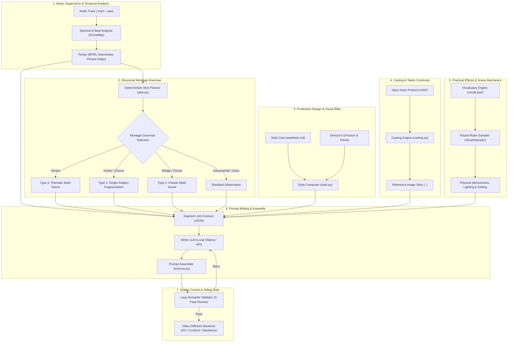

# Writing visual direction

Adapted from hellonearthis's studio-direction guide for the controls and engine
actually present in this public application.

Describe a coherent visual idea: the environment, what the subject does, the
mood and a few recurring motifs. Choose a style preset for the photographic
look and cast actors when recurring character identity matters.

For example:

> A lone maintenance worker explores an abandoned coastal power station at
> dawn. Salt-stained concrete and windblown cloth recur throughout. Movement
> starts restrained and becomes energetic with the music. Keep the imagery
> fully clothed, non-violent and grounded in practical materials.

## What the controls do

- **Visual direction** supplies production-wide instructions to the writer.
- **Style** supplies lighting, palette, texture and other aesthetic directives.
- **Conceptual theme** supplies a thematic anchor to passage-writing jobs.
- **Lyrics** can inform imagery; they do not replace the uploaded song or control
  the musical analysis.
- **Cast** supplies recurring identities, reference slots and content riders.
  Loose reference images also occupy reference slots in this engine; do not
  assume they are guaranteed to be used only for mood or lighting.
- **Reference policy**, **Casting policy**, **Ensemble mode** and **On-screen count**
  govern assignment, reference image binding, and shared shots. Selecting several
  actors alone does not require shared shots or eliminate uncast background figures.
- **Visual vocabulary** keeps the full current pool or selects the optional
  reduced flash/strobe cues. Neither choice certifies the generated output.

## Character consistency and eliminating random subjects

When using character sheets or additional reference images, you can eliminate unwanted one-off strangers and enforce strict cast continuity across the production:

- **Reference policy (`ref_policy`)**:
  - `fragmentation`: Wires reference sheets only to peak-energy passages. Lower-energy, multi-scene, or intro passages carry zero reference slots, prompting the AI writer to generate uncast, anonymous figures (e.g. "a farrier in an evidence locker").
  - `single_subject`: Wires reference sheets to both fragmentation and standard single-subject passages.
  - `all`: **Wired across every passage in the entire video.** The writer contract strictly mandates that the assigned cast member overrides generic subject rules and appears in every shot of that passage. Use this to completely eliminate uncast strangers.
- **Cast assignment (`casting_policy`)**:
  - `section`: Holds the same character through an entire musical section (verse or chorus) before switching, providing coherent narrative progression.
  - `rotate`: Strict sequential round-robin alternation between characters passage-by-passage.
  - `random`: Seeded fair random selection across passages.
- **Ensemble mode & Actors on screen (`ensemble_mode`, `on_screen`)**:
  - `off`: Exactly one character at a time per passage.
  - `always`: Guarantees that the requested on-screen count (e.g. 2) share every eligible frame.
  - `mixed`: Solos during quiet sections, ensemble during peaks.

## What stays under planner control

MMV analyzes the uploaded audio for beats, downbeats, energy and musical
sections. Its seeded planner owns passage durations, cut positions, shot counts,
montage grammar and reference-slot counts. The writer fills visual content into
that structure. Describing an exact cut in prose does not override the plan.

The four montage grammars are standard, thematic multi-scene, chaotic
multi-scene and single-subject fragmentation. Their use responds to musical
energy, with camera/shot instructions and vocabulary included in each writer job.

## Review and revision

Music-video prompts pass schema checks and Laya semantic review before rendering.
Local writers get up to three total attempts per passage, with validation
feedback supplied on corrective attempts. API writers get one attempt, avoiding
automatic extra paid calls. A rendering-provider rejection does not trigger
this prompt rewrite loop.

For different creative instructions, change the form and generate a new preview
before starting another production. Changing form text during an active run
is not a live rewrite of that run. Cached validated prompts are reused only
where their composed instructions and passage job match; turn off reuse or clear
the cache when deliberately requesting fresh wording.

Use content controls and actor riders, and review actual output. Style language,
prompt review and reference conditioning do not guarantee visual quality,
identity fidelity, rights clearance or SFW output.

---

# Studio Direction & Video Prompting Architecture

This guide details the prompt construction architecture of Mondo Music Video, translating the generative pipeline's internal mechanisms and "skills" into the established language of a professional film and music video production studio. It also provides the technical post-mortem on the "floating paper" phenomenon and explains how directors can steer scene elements through the user interface.

---

## 1. Studio Hierarchy & Departmental Architecture

Rather than prompting video generation models with monolithic text paragraphs, Mondo operates like a film studio where specialized departments handle distinct creative disciplines. Each department contributes deterministic constraints, musical math, or artistic bibles before the prompt writer ever drafts a single scene.



### 1.1 Music Supervision & Editorial Rhythm (The Audio Department)
- **Engine Module**: `mmv/engine/analyze.py` (`ScoreMap`)
- **Studio Analogy**: Music Editor & Choreographer
- **Function**:
  Music videos are cut to rhythm, not clock time. The audio engine analyzes the track using spectral flux, onset detection, and beat tracking (`aubio` or `librosa` with robust fallback heuristics).
  - Identifies overall tempo (BPM) and maps every beat frame and downbeat frame.
  - Groups musical bars into coherent musical phrases (e.g., 2 or 4 bars per phrase).
  - Ensures every planned cut lands precisely on an editorial downbeat.

### 1.2 Directorial Montage & Camera Grammar (The Director's Chair)
- **Engine Module**: `mmv/engine/plan.py`
- **Studio Analogy**: Lead Director & Senior Editor
- **Function**:
  Maps the song's energetic contours to one of four directorial montage structures:
  1. **Standard Observation**: Sustained takes, single dominant subject, steady lighting and environment. Best suited for contemplative interludes or slow instrumental builds.
  2. **Type 1: Single-Subject Fragmentation**: Rapid, rhythmic cutting centered on a single recurring lead character. Used on song hooks and choruses to anchor star presence while varying camera angles, scales, and focal lengths.
  3. **Type 2: Chaotic Multi-Scene**: Rapid, discontinuous, collision montage. Every cut introduces a new subject, setting, and act. Designed for build-ups, breakdowns, or climactic sonic overload.
  4. **Type 3: Thematic Multi-Scene**: Conceptual montage where disparate subjects and settings are linked by a single recurring physical or poetic anchor (the `thematic_anchor`).

### 1.3 Production Design & Cinematography Bible (Art Department & DP)
- **Engine Module**: `mmv/engine/style.py` & `mmv/engine/styles/`
- **Studio Analogy**: Production Designer & Director of Photography
- **Function**:
  Establishes the visual world before a scene is described:
  - **Aesthetic Cards (`aesthetic.md`)**: Specifies film stock, grain texture, color timing/grading, lens distortion, depth of field, and lighting logic.
  - **Refusal Rules**: Explicitly lists what the camera refuses to depict (e.g., clean digital smoothing, artificial lens flares, specific color shifts).
  - **Style Harvesting**: Can ingest user-supplied still images and deconstruct them through computer vision into craft rules, color gamuts, and composition grammars.

### 1.4 Talent & Casting Continuity (Casting Department)
- **Engine Module**: `mmv/engine/actor.py` & `mmv/engine/casting.py`
- **Studio Analogy**: Casting Director & Wardrobe Stylist
- **Function**:
  Maintains character identity and wardrobe across generative diffusion models:
  - Leverages the **Open Actor Protocol (OAP)** to bind facial reference sheets and identity manifests to reference image tags (`<Picture 1>`, `<Picture 2>`).
  - Enforces the hard rule: **"One dominant subject per shot"** to prevent cross-character identity bleed in diffusion models.
  - Locks costume design so character clothing remains consistent across separate render cuts.

### 1.5 Practical Effects & Physical Dynamics (SFX Department)
- **Engine Module**: `mmv/engine/config/vocab.json` & `VocabSampler`
- **Studio Analogy**: Practical Effects (SFX) Supervisor & Stunt Coordinator
- **Function**:
  Provides tactile, physical motion inside the frame to prevent "static waxwork" diffusion outputs. Injects practical camera dynamics, lighting states, and environmental mechanisms (wind, light pulses, reflections, water ripples, moving shadows).

### 1.6 Performance Rigging & Lip-Sync Suppression (Actor Coaching)
- **Engine Module**: `mmv/engine/schema.py`
- **Studio Analogy**: Dialogue Coach & Choreographer
- **Function**:
  AI video models tend to hallucinate rubbery, unnatural lip-sync or rubber-mouthed mumbling when music plays.
  - When **Silent Mouths** is active (the default for every production, with or without lyrics), prompts strictly mandate: `"lips firmly sealed shut, jaw completely relaxed, natural breathing"`.
  - When natural mouths or performance shots are enabled, facial movement is relaxed and articulated for singing or expression.

### 1.7 Diegetic Sound Design (Sound Design & Foley)
- **Engine Module**: `mmv/engine/prompts/writer_base.md` (`overall_soundscape`)
- **Studio Analogy**: Foley Artist & Sound Designer
- **Function**:
  While the song's master music track is placed in post-production (`non_diegetic_music: N/A`), video diffusion engines (such as Hailuo / MiniMax H3) model picture and sound jointly. Writing rich diegetic foley descriptions (e.g. wet asphalt, rustling coats, distant sirens, wind through grates) significantly improves the physical realism and weight of on-screen motion.

### 1.8 Quality Assurance & Studio Continuity Gate (Studio Executive)
- **Engine Module**: `mmv/engine/validators/laya_semantic.py`
- **Studio Analogy**: Studio Continuity Supervisor & Broadcast Standards
- **Function**:
  Before any prompt is dispatched to a GPU or API provider, Laya runs a 3-pass semantic and structural audit:
  - Validates that every planned shot has an explicit, concrete action.
  - Checks visual density and word budgets.
  - Enforces restriction compliance (prohibiting nudity, blood, violence, or sexual content).
  - If a prompt fails, generates corrective notes and forces the writer to retry.

---

## 2. Anatomy of a Segment Job Contract & Assembled Prompt

When a music video segment is generated, the pipeline compiles a strict JSON job contract for the writer:

```json
{
  "segment_id": "seg002",
  "montage_type": "type3_thematic_multi_scene",
  "thematic_anchor": "reflections rippling across glass",
  "duration_seconds": 6.8,
  "shot_count": 3,
  "footage_anchor": "Cinematic music-video photography",
  "practical_effects": "Wind, moving fabric, and shifting light",
  "rigging": "lips firmly sealed shut, jaw completely relaxed",
  "audio_tag": "<Audio 1>",
  "picture_tags": ["<Picture 1>"],
  "theme": {
    "conceptual_theme": "solitude"
  },
  "shots": [
    {
      "n": 1,
      "duration_seconds": 2.2,
      "shot_scale": "medium shot",
      "camera": "The camera pushes in with small amplitude at slow speed",
      "energy_0_to_1": 0.35,
      "vocabulary": {
        "setting": "rain-washed city street",
        "subject_type": "musician in a tailored jacket",
        "mechanism": "reflections rippling across glass",
        "lighting": "warm side light",
        "tonal_register": "quiet reflection",
        "costume": "tailored streetwear"
      }
    }
  ]
}
```

The writer responds with structured prose, which `schema.py` compiles into the final multi-field production prompt:
1. `subject_definitions:` Formal binding of characters and references.
2. `summary:` Editorial overview and reference tracking.
3. `retention_analysis:` Verification of character traits across shots.
4. `detailed_description:` Timecoded cut sequence (`[Shot 1] At 00:02.200, cuts to...`) embedding camera moves, character actions, and environmental dynamics.
5. `overall_soundscape:` Rich diegetic room tone and physical sound.
6. `non_diegetic_music:` Always locked to `N/A`.

---

## 3. Investigation: The "Floating Paper" Phenomenon

### 3.1 The Observation
In generated videos, directors frequently notice unexpected sheets of paper, fluttering flyers, drifting newspapers, or swirling documents appearing across scenes, even in settings where paper makes no narrative sense (e.g., desert roads, shorelines, or moody interiors).

### 3.2 Root Cause Analysis

The occurrence is caused by the interaction of three architectural elements in the engine:

#### 1. The Original 5-Item Mechanism Bottleneck (Resolved in 1.0.15)
Originally, `mmv/engine/config/vocab.json` contained only five entries in the practical mechanisms table:
```json
"mechanisms": [
  "wind moving fabric",
  "reflections rippling across glass",
  "moving shadows",
  "paper turning in the breeze",
  "lights pulsing across surfaces"
]
```

#### 2. Deterministic Sampling Without Replacement
In `mmv/engine/plan.py`, the `VocabSampler.pick()` algorithm pulls from this table using a cycle without replacement:
```python
def pick(self, table: str) -> str:
    pool = list(self.vocab[table])
    seen = self.used.setdefault(table, [])
    remaining = [x for x in pool if x not in seen]
    if not remaining:
        seen.clear()
        remaining = pool
    choice = self.rng.choice(remaining)
    seen.append(choice)
    return choice
```
When the list contained only 5 items, `"paper turning in the breeze"` had a **20% chance per pick** and was **mathematically guaranteed to be drawn once every 5 mechanism picks**.

In **1.0.15**, `vocab.json` expands `"mechanisms"` to **32 practical cinematic and micro-performance dynamics**, reducing the selection frequency of `"paper turning in the breeze"` from **20% down to ~3%**.

#### 3. Section Anchor Inheritance
When a section is assigned `type3_thematic_multi_scene`:
```python
anchor = sampler.pick("mechanisms") if montage_type == THEMATIC else None
# ...
sh.vocab["mechanism"] = anchor or sampler.pick("mechanisms")
```
Whatever mechanism is drawn as the `thematic_anchor` is inherited across **every single shot in that segment** as its binding physical anchor.

#### 4. The Writer Contract Hard Rule
In `writer_base.md`, the writer LLM is strictly instructed:
> *"The planner has already computed, and you must not attempt to influence... which vocabulary each shot draws on."*
> *"type3_thematic_multi_scene — every shot a new subject and setting, all obeying the thematic_anchor. Name the anchor explicitly in summary."*

When `"paper turning in the breeze"` is selected, the writer LLM dutifully complies by inventing reasons for paper to appear in every shot (e.g., *"a discarded newspaper drifts across the asphalt"*, *"sheets flutter from an open briefcase"*, *"paper pages turn softly on the table"*).

#### 5. Latent Space Diffusion Bias
Diffusion video models (such as MiniMax / Hailuo H3) have high latent sensitivity to the words *"paper"* and *"breeze"*. When instructed that paper is turning in the breeze, the model frequently generates surreal, gravity-defying floating sheets of paper drifting through the frame.

---

## 4. How Directors Can Steer & Override Scene Mechanics

### 4.1 The Expanded 32-Mechanism Studio Pool

`mmv/engine/config/vocab.json` provides 32 ambient, physical, and micro-performance mechanisms:
1. `"wind moving fabric"`
2. `"curtains billowing in a gentle draft"`
3. `"overhead hanging wires or pendant lamps gently swaying"`
4. `"paper turning in the breeze"`
5. `"loose hair tendril shifting across the cheek on exhalation"`
6. `"pre-speech breath intake lifting the chest and parting lips"`
7. `"moving shadows"`
8. `"long shadows stretching across the floor"`
9. `"venetian blind shadow slats raking across surfaces and skin"`
10. `"dappled sunlight shifting through tree foliage"`
11. `"reflections rippling across glass"`
12. `"rain rivulets shearing diagonally down glass"`
13. `"condensation beads slowly trickling down cold surfaces"`
14. `"melting ice cubes settling and shifting in a glass"`
15. `"water caustics rippling across interior walls and ceilings"`
16. `"liquid meniscus trembling in a glass from ground vibration"`
17. `"concentric ripples expanding across a puddle from an off-screen drip"`
18. `"heat shimmer warping the distant horizon"`
19. `"airborne dust motes drifting through raking natural light"`
20. `"low-lying fog or mist creeping across the ground plane"`
21. `"steam rising and curling into cool air"`
22. `"ash tip lengthening and crumbling from a burning cigarette"`
23. `"passing car headlights sweeping sharp beams across interior walls"`
24. `"fluorescent ballast micro-flicker"`
25. `"television flicker projecting fluctuating bounce light"`
26. `"masseter jaw muscle knotting and releasing along the jawline"`
27. `"rapid ocular saccades scanning between focal points"`
28. `"waterline sheen accumulating along the lower eyelid margin"`
29. `"visible glottal swallow shifting the larynx during silence"`
30. `"subtle lens breathing during shallow rack focus"`
31. `"foreground silhouette wiping across the lens during lateral track"`

### 4.2 Using the Web UI Controls

The Mondo web interface provides two direct channels into the prompt writing engine:

#### 1. Visual Direction (`direction`)
In the web interface under **Visual direction**, any text entered is appended directly to the LLM system prompt under:
```text
DIRECTOR'S DIRECTION:
{user_direction}
```
Because this block sits after the base rules, strong writer models treat it as active director notes.

**To completely prohibit paper and floating debris:**
Enter explicit practical directives in your Visual Direction, for example:
> *"Ground all environmental physics in wet reflections, heavy rain, and atmospheric mist. Do not include loose papers, documents, flyers, or litter. Keep all surfaces industrial and solid."*

**To lock a specific environmental element:**
> *"The recurring visual mechanism across all scenes must be swirling embers, drifting dust motes, and neon light pulses on wet metal."*

#### 2. Conceptual Theme (`conceptual_theme`)
The **Conceptual theme** input (e.g. *"nostalgia"*, *"cybernetic isolation"*, *"grief"*, *"kinetic velocity"*) provides the emotional and metaphorical thread. While it does not directly replace vocabulary keywords, it gives the writer LLM the *purpose* behind the physical movement, discouraging generic interpretations of prompt mechanisms.

---

## 5. Director's Quick Reference & Troubleshooting

| Observation | Studio Department | Underlying Cause | Director's Remedy |
| :--- | :--- | :--- | :--- |
| **Floating paper or flyers in a shot** | SFX / Vocab | Draw of `"paper turning in the breeze"` (4% pool weight in `vocab.json`). | Reroll the variation seed, or add *"Do not depict loose paper, documents, or flyers"* in **Visual direction**. |
| **Unnatural mouth twitching or phantom singing** | Actor Coaching | Natural expressions was selected, or an older version skipped silent mouths when no lyrics were entered. | Keep **Silent Mouths** (the default); it no longer depends on lyrics. |
| **Characters morphing or changing clothing** | Casting | Identity bleed across parallel subjects or missing OAP actor assignment. | Assign an OAP actor reference sheet; ensure **"One dominant subject per shot"** rule is observed. |
| **Cuts feel off-beat or disconnected from song** | Editorial | Incorrect bars-per-phrase grid or non-standard time signature. | Adjust **Bars per phrase** (try 2 or 4 bars) or re-run beat detection with adjusted sensitivity. |
| **Scenes look too clean, sterile, or CGI** | Production Design | Default clean grading without film stock or grain directives. | Harvest a style from moody cinematic reference stills or specify 35mm grain, lens distortion, and bloom in Visual Direction. |

---

## 6. Power-User Production Tips & Studio Best Practices

### 6.1 Passage Takes & Single-Clip Rerolls (Lossless Direct Assembly)

In professional music video direction, you rarely scrap an entire reel when nine out of ten shots are great and only one has an awkward camera turn or artifact. Mondo’s **Passage Takes** workflow lets you fine-tune and reroll individual clips without re-rendering the whole song:

1. **Open the Edit View**: On any finished `local_h3` production, navigate to the production card and click **Edit Passages**.
2. **Review Individual Passages**: Each passage card presents the prompt on the left (character count, validated against renderer limits) and the rendered clip take on the right.
3. **Reroll Just One Clip**:
   - Enter a **Next seed** (or press **Random**) and click **🎬 Render Clip**. Only that specific segment runs through your local GPU.
   - Or click **✍️ Write new prompt** to regenerate that passage’s narrative prompt with fresh vocabulary draws, or **✏️ Edit prompt** to manually tweak lighting, camera motion, or action. Hand edits pass through the same Mondo quality rules and Laya validator to guarantee visual consistency.
4. **Reassemble the Master Losslessly**:
   - Use the take selector to preview and pick your favorite takes for each passage.
   - Click **Re-encode Final Video with Selected Takes**.
   - Mondo reconstructs the entire final video directly from the original renderer clips in a single FFmpeg encode, applying subliminal flashes and burned lyric captions inside that assembly graph. This prevents generational loss from recompressing finished MP4s, and preserves earlier video iterations in the Final Video Version dropdown.

### 6.2 The "Two Seeds" Mechanic (Variation Seed vs. Render Seed)

Mondo separates narrative composition from diffusion rendering using two distinct random seeds:

* **Variation Seed (`variation_seed`) — The Narrative & Editorial Blueprint**:
  - Dictates which visual vocabulary items are drawn from `vocab.json`.
  - Determines shot breakdown, camera progression, metaphorical motifs, and actor casting across musical sections.
  - Controls the text prompts generated by the LLM writer.
* **Render Seed (`seed` / Take Seed) — The Diffusion Noise Generator**:
  - Dictates the latent noise seed passed to the video diffusion renderer (e.g. MiniMax H3 via ComfyUI).
  - Controls physical micro-details: exact facial expressions, cloth folds, hair physics, volumetric lighting, and particulate drift.

> [!TIP]
> **Director's Workflow:**
> If you love the story arc, shot rhythm, and visual symbolism of a production but want to see different stylistic or physical interpretations, **keep the Variation Seed locked** and change the Render Seed (or reroll individual passage takes). Conversely, if the visual physics look solid but you want completely fresh scenes and narrative metaphors, change the **Variation Seed**.

### 6.3 Lip-Sync & Approved Singing (Overriding Sealed Lips)

By default, Mondo enforces **Silent Mouths** (sealed lips) across all passages. This intentional constraint eliminates unnatural mouth spasms, phantom mumbles, and the uncanny-valley morphing common in open-domain video models when unprompted speech occurs.

To produce authentic, synchronized performance shots without phantom glitches:

1. **Provide Song Lyrics**: Paste the lyrics into the **Lyrics** field on the Music Video panel.
2. **Assign a Singer**: In actor casting, designate a character as the lead singer/vocalist, or choose **Approved Singing** under Actor Coaching.
3. **Protected Scheme Validation**:
   - Mondo's protected scheme strictly confines singing prompts to designated musical singing passages and formats them with approved phonetic cadence phrasing.
   - During guitar solos, drum fills, instrumental interludes, and non-singing verses, Mondo automatically reverts to sealed-lips instructions, keeping actor facial performance grounded and realistic.

### 6.4 Reference Sheet Geometry & Neutral Backgrounds for MiniMax H3

Diffusion video models such as MiniMax H3 rely on image cross-attention to inject character identity into dynamic scenes. The cleanliness and composition of your actor reference sheets directly affect how well the character integrates into the video:

* **Use Neutral, Uncluttered Backgrounds**:
  - Avoid complex scenic backgrounds in your actor portrait reference images (studio grey `#808080`, pure white `#FFFFFF`, or transparent work best).
  - Background objects in reference sheets can unintentionally bleed into video scenes (e.g., a bookshelf or window in a portrait can cause unwanted furniture or window frames to spawn in an outdoor desert or sci-fi shot).
* **Composition & Turn**:
  - A crisp waist-up or three-quarter turn with clear facial features, defined jawline, and distinctive clothing textures provides the best cross-attention anchor.
  - For vertical (9:16) videos, use vertical or waist-up references to avoid aspect-ratio stretching.
* **Automatic Native Tag Normalization**:
  - MiniMax H3 natively binds character conditions via numbered tag notation (e.g., `<Subject 1>`, `<Subject 2>`).
  - Mondo automatically normalizes reference tags and prompt names so your cast members connect directly to H3's subject cross-attention slots without manual prompt hacking.

### 6.5 Resolution Density & Aspect Scaling for Social vs. Cinema

Optimize your video dimensions and computational density for your target exhibition platform:

* **9:16 Vertical Video (Social Platforms)**:
  - Select **9:16** for TikTok, Instagram Reels, and YouTube Shorts.
  - Pair with waist-up or vertical character references so subjects fill the vertical framing naturally without awkward wide-angle cropping.
* **2.39:1 / 21:9 Anamorphic Cinemascope (Widescreen Cinema)**:
  - Select **21:9** or **2.39:1** for theatrical aspect ratios, sweeping landscapes, and widescreen anamorphic lens characteristics.
* **VRAM and Speed Tuning (`megapixels`)**:
  - Use `0.9`–`1.0` megapixel targets (~720p equivalent) for rapid storyboard iteration and lower VRAM consumption on consumer GPUs.
  - Scale up to full 1080p density for final mastering once your shot selection and takes are locked.

### 6.6 Prompt Caching vs. Fresh Writing (`reuse_prompts`)

Writing comprehensive, Laya-validated prompts for an entire song takes time and (when using API writer models such as Claude, OpenAI, or Gemini) consumes API tokens.

* **When iterating on visual looks, lighting LUTs, or render seeds**: Enable **Reuse Prompts / Cached Prompts**. Mondo skips the writer stage entirely, pulling the approved passage prompts from the previous run and sending them directly to the video renderer.
* **When restructuring song cuts, lyrics, or core narrative arcs**: Leave prompt caching disabled so the writer generates fresh, musically aligned prompts adapted to your changes.

### 6.7 Blending Multi-Thematic Worlds with Guided Visual Anchors

The **Worlds** panel enables rich environmental design beyond single-genre stereotypes. Rather than choosing strictly between a conventional cyberpunk alley or a rustic forest, you can create hybrid visual universes:

* **Architectural Anchor + Atmospheric Modifier**:
  - In **Visual Direction**, combine architectural permanence with dynamic environmental physics:
    > *"Brutalist monolithic concrete towers overgrown with luminescent bioluminescent vines, bathed in continuous monsoon rain and amber sodium-vapor floodlights."*
* **World Presets & Guided Sliders**:
  - Use the World editor to define spatial consistency: interior vs. exterior transitions, material palettes (e.g. brushed titanium, wet asphalt, rusted corrugated iron), and dominant color temperatures.
  - The writer LLM weaves these environmental anchors into every passage prompt, while the vocabulary engine injects varied micro-mechanisms (steam vents, puddles, electrical arcs) to prevent visual repetition across takes.
